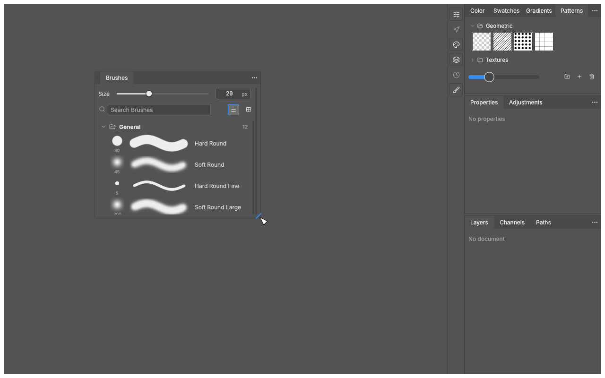

# Correção de redimensionamento dos painéis do PhotoCraft

[Baixar pacote com patches e instruções](photocraft-panel-resize.zip)

A alteração permite redimensionar os painéis flutuantes pelas quatro bordas e quatro cantos, com cursor correspondente à direção do arraste e limites de tamanho.

Validação no Linux: 3.198 testes aprovados no PhotoCraft e 84 na biblioteca compartilhada, nenhuma falha e 13 testes ignorados pelo projeto. Clippy, formatação, arquitetura e 25 verificações de WebAssembly passaram.

O ZIP contém patches para `storytold/craft-libs` e `storytold/photocraft`, instruções em português e inglês, relatório de validação e capturas. A execução no Windows requer compilar o código com a biblioteca corrigida.

## Painel antes de aumentar

## Painel depois de aumentar

As capturas mostram o painel real em renderização offscreen. O renderizador de testes desenha um ponteiro genérico; a direção do cursor é verificada separadamente pelos testes.
