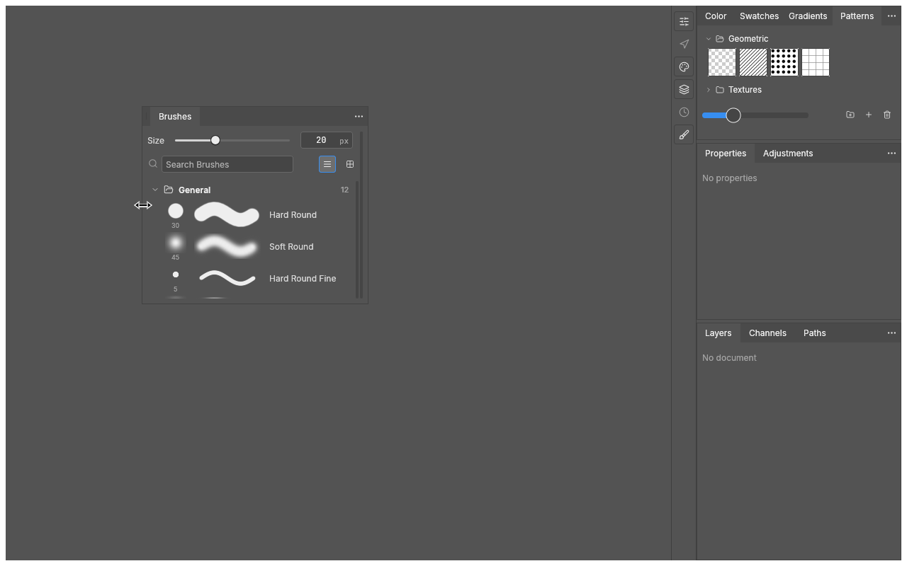
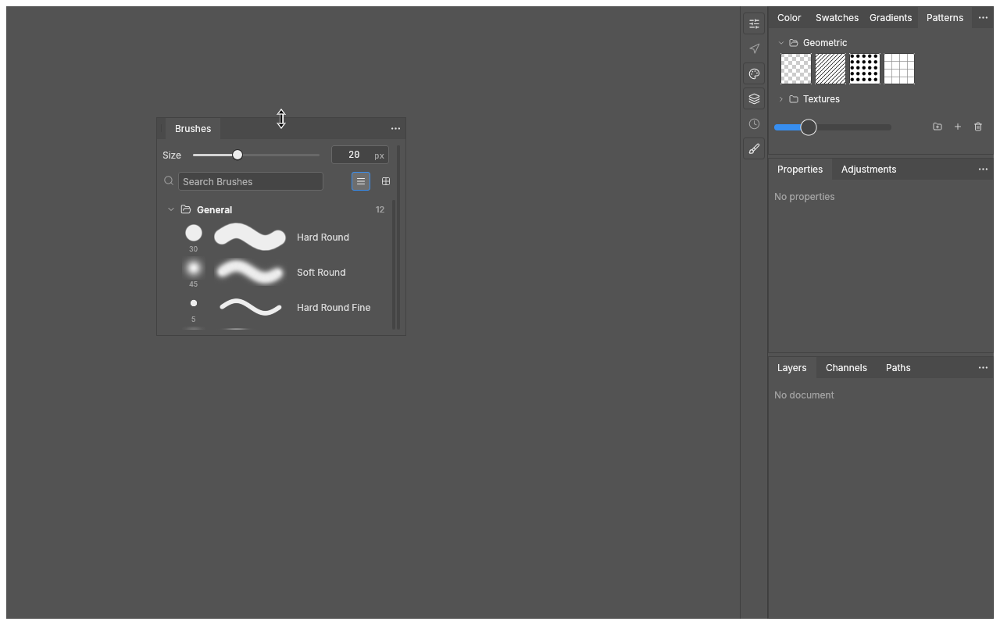
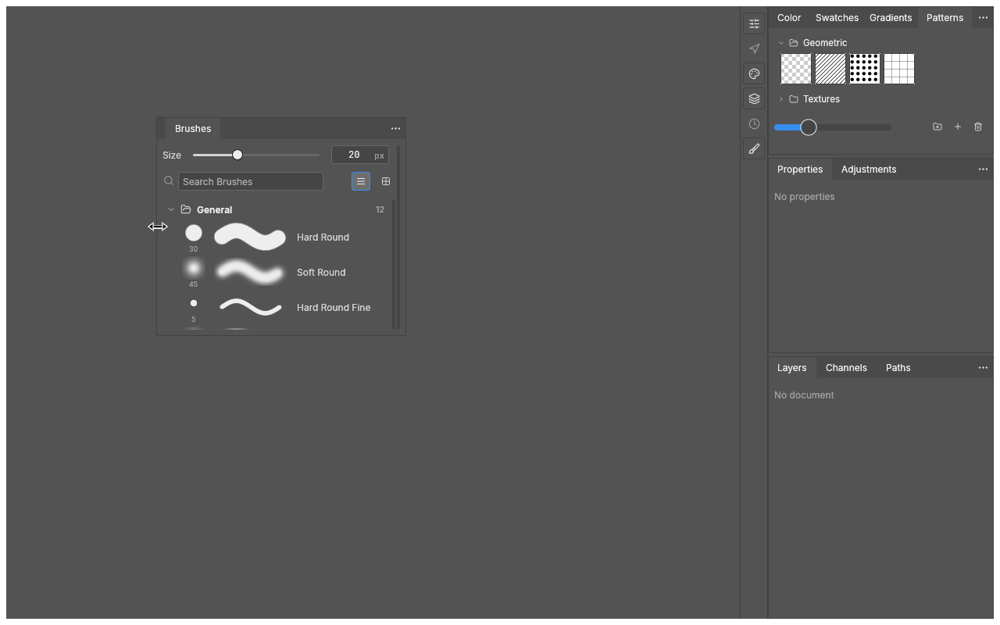
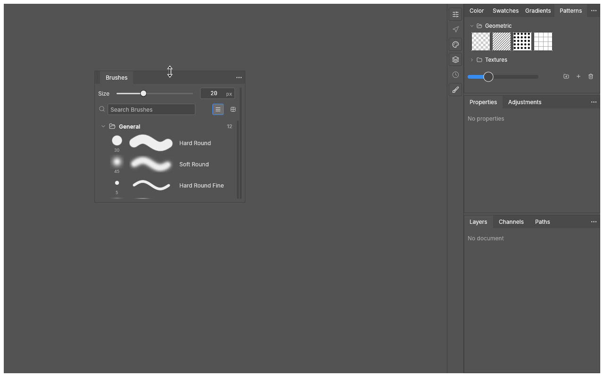

# Correção de redimensionamento dos painéis do PhotoCraft

[Baixar pacote com patches e instruções](photocraft-panel-resize.zip)

Antes da correção, o painel compartilhado só oferecia uma alça no canto inferior direito.
As demonstrações abaixo mostram **regiões que antes não redimensionavam**. São sequências de quadros do painel real, geradas por eventos de mouse no teste de integração.

## Borda esquerda: a direita fica parada

O mouse começa no meio da borda esquerda, afastado dos cantos. O arraste aumenta a largura em 96 pontos, mantendo a borda direita na mesma posição.

## Borda superior: a inferior fica parada

O mouse começa no meio da borda superior. O arraste aumenta a altura em 96 pontos, mantendo a borda inferior na mesma posição.

## Canto superior esquerdo

As duas dimensões aumentam ao mesmo tempo, mantendo o canto inferior direito parado.

## Evidências das oito regiões

Todas começam com o painel em `x=200, y=150, largura=320, altura=280`.
As posições e tamanhos abaixo são conferidos por asserções no estado real do layout após cada gesto.

| Região | Animação | x final | y final | Largura final | Altura final |
| --- | --- | ---: | ---: | ---: | ---: |
| Borda esquerda | [GIF](imagens/borda-esquerda-cursor.gif) | 104 | 150 | 416 | 280 |
| Borda direita | [GIF](imagens/borda-direita-cursor.gif) | 200 | 150 | 416 | 280 |
| Borda superior | [GIF](imagens/borda-superior-cursor.gif) | 200 | 54 | 320 | 376 |
| Borda inferior | [GIF](imagens/borda-inferior-cursor.gif) | 200 | 150 | 320 | 376 |
| Canto superior esquerdo | [GIF](imagens/canto-superior-esquerdo-cursor.gif) | 104 | 54 | 416 | 376 |
| Canto superior direito | [GIF](imagens/canto-superior-direito-cursor.gif) | 200 | 54 | 416 | 376 |
| Canto inferior esquerdo | [GIF](imagens/canto-inferior-esquerdo-cursor.gif) | 104 | 150 | 416 | 376 |
| Canto inferior direito (já existia) | [GIF](imagens/canto-inferior-direito-cursor.gif) | 200 | 150 | 416 | 376 |

## Setas de redimensionamento

- Laterais: **↔**, cursor horizontal (`ResizeHorizontal`).
- Superior e inferior: **↕**, cursor vertical (`ResizeVertical`).
- Cantos: seta diagonal (`ResizeNwSe` / `ResizeNeSw`).

O renderizador de testes agora desenha setas duplas **a partir do `CursorIcon` realmente emitido pela interface**, em vez do ponteiro genérico. A alteração de captura está disponível em `03-test-renderer-cursor.patch` no ZIP. São renderizações de teste; no Windows, o aplicativo usa o desenho nativo do sistema (`IDC_SIZEWE`, `IDC_SIZENS` e diagonais), da mesma família da alça existente. As imagens não são uma gravação do Windows.

## Validação e contribuição

A implementação de produção permanece a mesma. Nesta atualização, o teste passou a salvar quadros de todas as oito regiões, usar arrastes mais visíveis de 96 pontos e conferir o cursor durante o arraste.

Validação original no Linux: 3.198 testes aprovados no PhotoCraft e 84 na biblioteca compartilhada, nenhuma falha e 13 testes ignorados pelo projeto. Clippy, formatação, arquitetura e 25 verificações de WebAssembly passaram. Após ampliar a captura, a suíte de docking com 31 testes foi executada novamente e passou.

O ZIP contém patches para `storytold/craft-libs` e `storytold/photocraft`, instruções em português e inglês, relatório de validação, quadros originais e animações. A execução no Windows requer compilar o código com a biblioteca corrigida.
